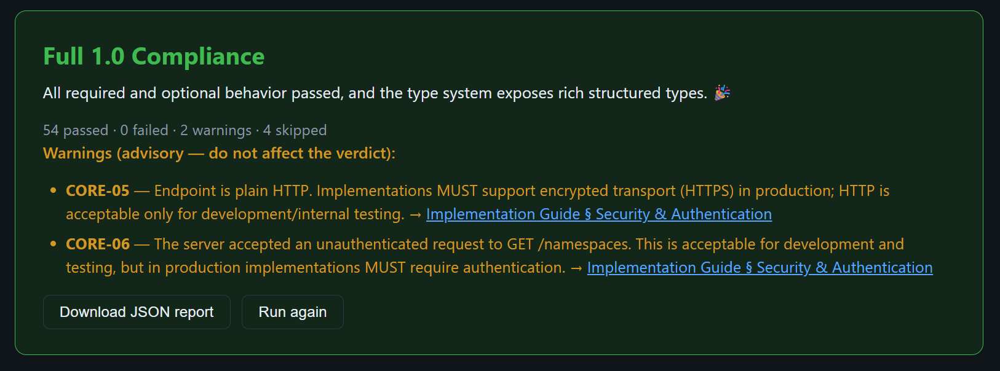
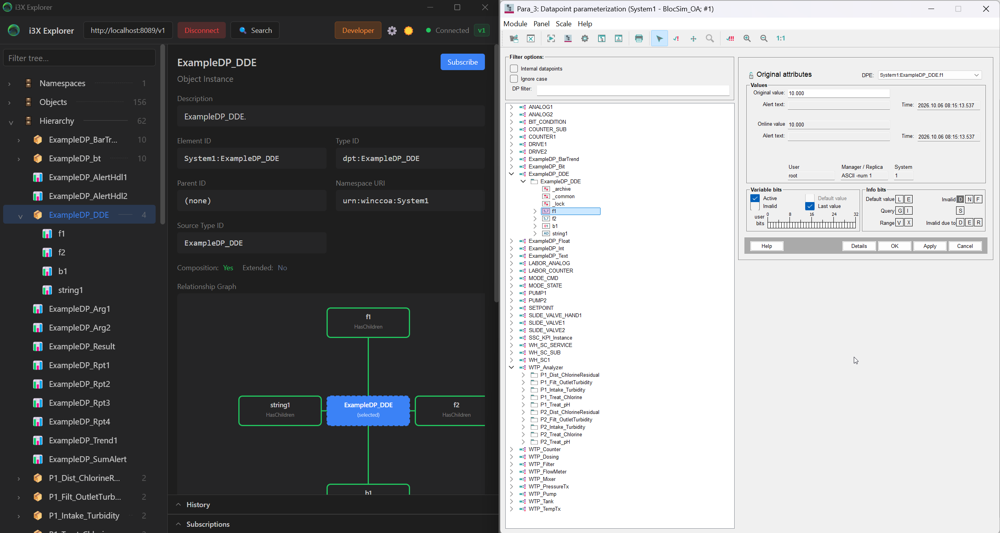
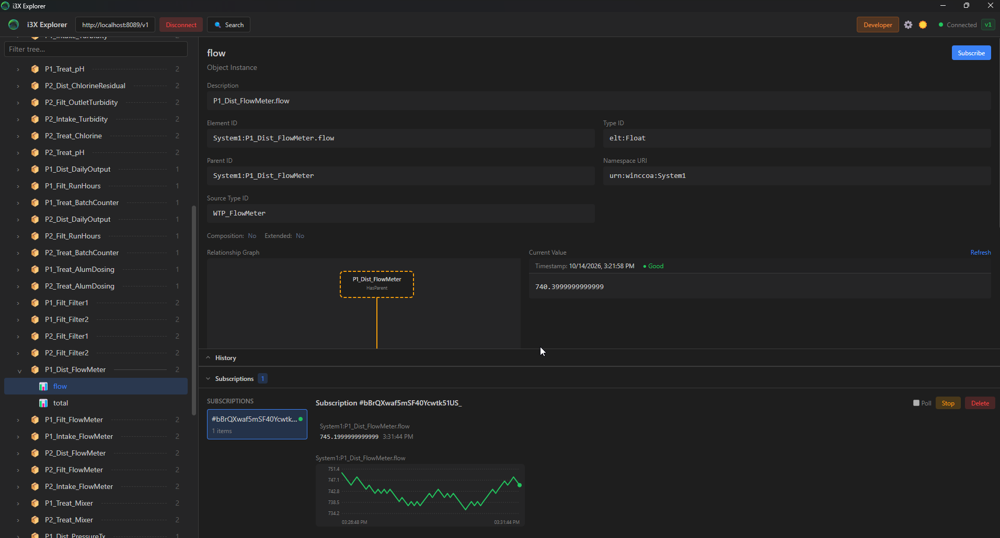

# OA_I3X - WinCC OA as an i3X Server

A WinCC OA JavaScript manager that exposes your PARA data (data point types, data points,
elements, live values, history, writes and subscriptions) over the
[CESMII i3X 1.0 REST API](https://www.i3x.dev/). Drop it into any WinCC OA 3.20+ project and
any i3X client can browse and read your data.

> **Developed by BlocIoT for educational purposes.** The code is provided as-is, without
> warranty of any kind. Conduct your own tests before deploying it in a production
> environment.

## Conformance

Tested with the official [i3X 1.0 Conformance Test Suite](https://github.com/cesmii/i3X/tree/main/conformance-tests)
against a live WinCC OA 3.21 project:



The two advisory warnings (plain HTTP, no authentication) disappear when you configure a
bearer token and TLS; see the [User Guide](docs/USER_GUIDE.md#6-security). The full JSON
report is in [docs/conformance-report.json](docs/conformance-report.json).

## Browsing with the i3X Explorer

PARA on the right, the same data point (`ExampleDP_DDE` with its elements `f1`, `f2`, `b1`, `string1`)
in the i3X Explorer on the left. The Hierarchy view mirrors the PARA tree one to one:



The official i3X Explorer connected to the manager, showing a WinCC OA data point element,
its type, parent, live value and a running subscription:



## Quick start

1. Copy [`i3x-manager/`](i3x-manager/) into `<your project>/javascript/i3x-manager`.
2. Add a **JavaScript Manager** in the WinCC OA Console with the option
   `i3x-manager/index.js` (or append `node | always | 30 | 3 | 1 | i3x-manager/index.js` to
   `config/progs`).
3. Start it and open `http://<host>:8089/v1/info`.

Full instructions, configuration, security and troubleshooting: **[docs/USER_GUIDE.md](docs/USER_GUIDE.md)**.

## What you get

| i3X concept | WinCC OA source |
|-------------|-----------------|
| Namespace | `urn:winccoa:<SystemName>` |
| Object types | Data point types, struct elements and primitive element kinds |
| Objects | Data points and their elements (`System1:Pump1.motor.temp`) |
| Hierarchy | DP > struct element > leaf, via `HasParent` / `HasChildren` |
| Current values | `_online.._value`, source time and invalid bit |
| History | `dpGetPeriod` on archived elements |
| Writes | `dpSetWait` / `dpSetTimedWait` (can be disabled) |
| Subscriptions | `dpConnect`, delivered by sync polling or Server-Sent Events |

No npm dependencies. Runs on the Node.js shipped with WinCC OA.

## Repository layout

```
i3x-manager/        the manager (copy this folder into your project)
  index.js          entry point and configuration
  lib/oa-backend.js WinCC OA <-> i3X mapping
  lib/i3x-server.js i3X protocol layer (routes, envelopes, auth, SSE)
  dev/              mock WinCC OA addon for development without a project
  test.js           self-check (npm test)
docs/USER_GUIDE.md  step-by-step guide for WinCC OA users
docs/               compliance report, Explorer screenshot and JSON report
```

## Development without WinCC OA

```sh
cd i3x-manager
npm test                      # self-check against the mock addon
I3X_MOCK=1 node index.js      # serve the mock on http://localhost:8089/v1
```

## License

MIT, see [LICENSE](LICENSE). Copyright BlocIoT.
